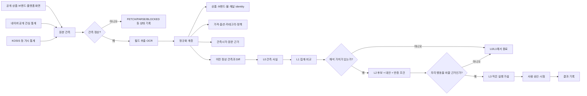
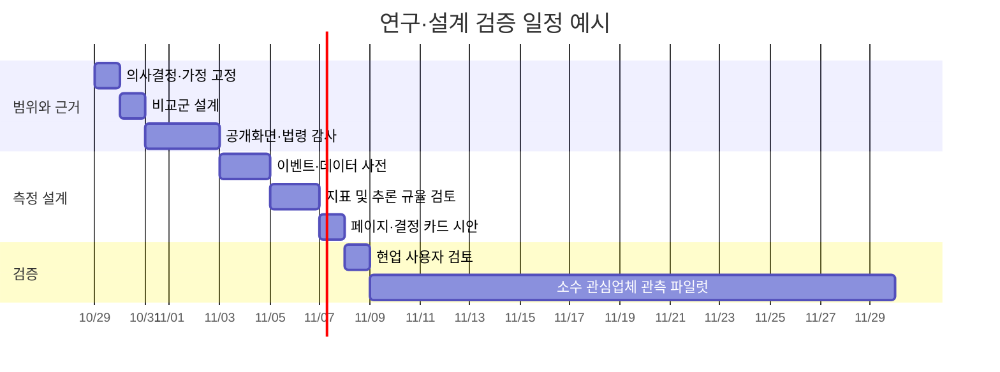

# 한국 패션 이커머스 공개정보 기반 의사결정 리서치 및 도구 설계 보고서

## 요약 및 앱 요구사항

**기준일: 2026년 10월 28일, Asia/Seoul.**

앱 콘텐츠는 2026년 10월 28일 작성·5차 개정된 **“한국 패션 이커머스 운영·기획 지표와 도구 설계용 심층 리서치 프롬프트”**다. 현재 단계는 도입 결정이나 구현이 아니라 연구·설계이며, 핵심 목적은 “경쟁사가 얼마나 팔았는가”를 추정하는 것이 아니라 **공개 화면에서 관측 가능한 행동을 근거로 실제 업무 결정을 설명할 수 있는 자료를 만드는 것**이다. fileciteturn0file0

가장 중요한 결론은 다음과 같다.

첫째, 이 프로젝트의 핵심 자산은 대형 브랜드 DB가 아니라 **잘 설계된 관심 비교군 + 일관된 사건 정의 + 원본 관측 이력**이다. fileciteturn0file0  
둘째, 판매량·매출·재고수량·전환·마진은 공개 데이터로 복원하지 말아야 하며, 품절·리뷰·랭킹을 우회적 판매량 추정치로 쓰는 것도 배제해야 한다. fileciteturn0file0  
셋째, 가격에서는 할인율 하나보다 **정가·판매가·할인표시의 개별 시계열**이 훨씬 중요하다. 기존 연구에서도 기준가격과 현재가격을 동시에 바꾸면 할인처럼 보이는 가격 인상이 가능함이 확인됐다. citeturn18search0  
넷째, 최초 관측일은 출시일이 아니며 일 1회 관측에서는 사건의 정확한 발생시각이 아니라 **두 정상 관측 사이의 발생구간**만 알 수 있다. 이것을 데이터 모델에 직접 반영해야 한다. fileciteturn0file0  
다섯째, 비교군은 하나로 고정하기보다 **직접 경쟁군과 목적별 참고군을 분리**하는 것이 낫다. 이것이 가격·디자인·프로모션·서비스 지표가 서로 다른 회사를 필요로 하는 문제를 해결한다.  
여섯째, 실제 공개 화면 검증 결과 29CM·지그재그·시엔느 등에서 가격·사이즈·배송·배지·옵션·설명 같은 상당수 항목은 확인할 수 있지만, 플랫폼별 표현과 동적 렌더링 차이가 커 **“필드 존재”와 “안정적 자동수집 가능”을 분리**해야 한다. citeturn16view0turn15view2turn16view4  
일곱째, 네이버 쇼핑인사이트는 검색·쇼핑 클릭의 상대적 관심 신호이며 판매량이 아니다. KOSIS 온라인쇼핑 통계도 거시 환경을 설명할 뿐 개별 경쟁사 실적을 설명하지 않는다. citeturn15view5turn2search2  
여덟째, 추천 도구 구조는 직군별 대시보드보다 **결정별 화면 + 공통 근거 카드**다. MD·경영·마케팅·디자인이 같은 사실을 다른 이유로 쓰기 때문이다.  
아홉째, AI의 적합한 역할은 추출·정규화·변경 탐지·후보 해석 생성까지이고, 비교군 선정·고비용 행동·법적 재사용 판단·경쟁사 의도 확정은 사람에게 남겨야 한다.  
열째, 먼저 만들어야 할 것은 종합 경쟁력 점수나 발주량 추천이 아니라 **가격·구성 비교, 사건 이력, 데이터 품질, 서비스 기준선, L0/L1/L2/L3 결정 카드**다. fileciteturn0file0

앱이 명시한 최종 산출물은 A의 맹점 검토, B의 직군·학문별 심화와 1~26 정보→판단 지도, 실제 화면 3~5건 검증, C의 웹페이지 설계, D의 최대 20개 추천 지표와 상위 5개, E의 자기반박이다. **전체의 70% 이상을 핵심 분석에 배정하고 한국어로 작성하며, 논문·법령·현장 화면을 확인해 주장 가까이에 근거를 붙이는 것이 요구된다.** fileciteturn0file0

앱 자체에는 완료 기한이 없으며, 사용자 요청에서도 별도 마감일은 지정되지 않았다. 구현 코드·로그인·구매·차단 우회·대량수집은 요구사항이 아니며, 오히려 명시적으로 범위 밖이다. fileciteturn0file0

**추출된 템플릿·필드·외부 인터페이스**

| 구분 | 앱에서 요구된 내용 | 연구 결과 |
|---|---|---|
| 데이터 필드 | 상품·몰·플랫폼·시계열 정보 1~26 | 아래에서 전 항목을 판단 지도로 재설계 |
| 추론 템플릿 | L0 관측 → L1 계산 → L2 조건부 해석 → L3 실행 가설 | 유지하되 모든 사실을 L3까지 강제로 올리지 않음 |
| L2/L3 검증 | 근거정보, 대안≥2, 반증조건, 표본·기간, 독립신호, 오판비용, 근거수준 | 결정 카드의 필수 메타데이터로 채택 |
| 실행 기록 | 문제 → 근거·한계 → 변경 1개 → 대상 → 기간·예산 → 성공/중단 → 결과 | 그대로 활용 가치가 높음 |
| 외부 공개통계 | 네이버 쇼핑인사이트, KOSIS 온라인쇼핑동향 | 보조 맥락 신호로만 사용 citeturn15view5turn2search2 |
| OCR | 이미지 속 명시 문자를 읽는 용도 | 제품 속성·품질 추론에는 사용 금지 |
| 특정 API | 프롬프트에는 API 스키마·키·인증방법이 없음 | 네이버 DataLab/Shopping Insight는 별도 공식 API가 존재함. citeturn15view5 |
| 앱 커넥터 | `app://connector_openai_deep_research` | 연구 의뢰 콘텐츠의 전달 경로이며, 프롬프트 안에는 실행 가능한 별도 커넥터 명세가 없음 |
| 출력 형식 | 한국어, 앞부분 15줄 이내 요약, 표/소제목, B 비중 70% 이상 | 본 보고서가 그 구조를 따른다. fileciteturn0file0 |

## 핵심 맹점과 분석 프레임

앱의 기존 설계는 이미 판매량 추정 금지, 최초 관측일과 출시일 분리, L0~L3 추론 규율 등 중요한 오류를 상당수 선제적으로 막고 있다. fileciteturn0file0 그럼에도 아래 문제가 남는다.

| 중요도 | 가장 큰 약점 또는 아직 던지지 않은 질문 | 왜 중요한가 | 수정 방향 |
|---|---|---|---|
| 매우 높음 | **“누구를 왜 비교하는가?”가 아직 지표보다 늦게 결정됨** | 비교군이 바뀌면 중앙값·가격 위치·컬러 비중·프로모션 빈도가 모두 바뀐다. | 모든 분석에 `peer_set_id`, 선정 이유, 유효기간을 저장 |
| 매우 높음 | 경쟁사 행동을 “결정”으로 읽는 프레임 자체가 과할 수 있음 | 화면에 보이는 것은 결과적 표시이지 내부 의사결정·성과가 아니다. | “행동”보다 **공개 상태 변화**라는 중립 용어를 기본값으로 사용 |
| 매우 높음 | 사이트 수집 실패와 실제 상품 소멸의 식별 | 이를 구분하지 않으면 상품 종료·카테고리 축소라는 가짜 사건이 생긴다. | HTTP/렌더/파싱/선택자 상태를 별도 수집 |
| 높음 | 같은 상품의 채널별 동일성 판정 | 플랫폼명·자사몰명·옵션구성이 다르면 가격차를 잘못 계산할 수 있다. | 상품 identity에 신뢰도 등급 부여 |
| 높음 | 상품 믹스 변화와 가격 변화의 혼동 | 비싼 신상품이 늘면 브랜드가 기존 제품 가격을 올리지 않아도 중앙값은 상승한다. | 동일 상품군 가격변화와 상품구성 효과를 분리 |
| 높음 | 공개 페이지의 개인화·지역·로그인 상태 | 동일 URL도 쿠폰·배송일·추천·노출순서가 달라질 수 있다. | locale/device/login/session 캡처 조건 기록 |
| 높음 | “디자인 트렌드” 분석의 입력 제약 | 사진에서 소재·핏·품질을 추론하지 않는다면 실제로 쓸 수 있는 디자인 변수는 판매자가 명시한 텍스트로 제한된다. | 텍스트 명시 속성과 시각 콘텐츠 형식 분석을 분리 |
| 중간 | 지표 생성 비용보다 검수 비용을 과소평가 | OCR·옵션·색상·상품 매칭 오류는 지표가 늘수록 누적된다. | 각 지표에 `검수분/의사결정 가치` 기록 |
| 중간 | 소형몰과 대기업 플랫폼의 의사결정 주기가 다름 | 복잡한 가격 최적화·재고 모델은 내부 수요·원가·재고가 필요한 경우가 대부분이다. 소매 assortment 문헌도 수요·대체·제약조건을 핵심 입력으로 다룬다. citeturn18search4 | 공개 데이터 도구는 “최적화”가 아니라 “근거 탐색·경보”에 집중 |
| 중간 | 도구가 실제 회의에서 어떤 질문에 답해야 하는가 | 지표가 많아도 회의의 결정을 바꾸지 못하면 유지비만 생긴다. | 화면마다 첫 질문 하나를 명시 |

**경쟁정보를 읽는 핵심 원칙.** Porter의 *Competitive Strategy*는 산업구조뿐 아니라 경쟁자 분석과 시장 신호를 체계적으로 해석하는 틀을 제시하지만, 그 틀이 “관측한 가격·배너 변화가 경쟁사의 실제 목표를 알려준다”는 뜻은 아니다. 원전의 용도는 경쟁행동을 구조적으로 질문하도록 돕는 것이므로, 여기서는 **가설 생성 장치**로 제한해 사용하는 편이 타당하다. citeturn18search10

따라서 다음 구조가 더 안전하다.

**관측 상태 → 상태 변화 → 가능한 설명 집합 → 구분 관측 → 필요할 때만 실행 가설.**

예를 들어 “정가 8만 원 → 10만 원, 판매가 7만 원 → 8만 원, 할인표시 12.5% → 20%”가 관측됐다고 하자. 이것으로 “브랜드가 할인 전략을 강화했다”고 바로 쓰면 안 된다. 직접 확인할 수 있는 것은 가격 구조가 변했다는 사실이다. Park·Xie·Xie의 Amazon 13개월 연구에서는 정가 기준과 실제가격을 동시에 바꾸어 가격 인상을 할인처럼 보이게 만드는 현상도 관찰됐다. 따라서 정가·판매가·할인율을 서로 독립적인 시계열로 보존해야 한다. 다만 그 연구는 Amazon 여러 카테고리 대상이므로 한국 여성복 개별 브랜드에 동일한 의도를 귀속시키는 근거는 아니다. citeturn18search0

**관심 리스트는 단일 경쟁사 목록이 아니라 목적별 레이어로 설계한다.** 아래 숫자는 업계 법칙이 아니라 **운영 부담을 줄이기 위한 설계 제안**이다.

| 레이어 | 선정 논리 | 주로 볼 것 | 권장 운용 방식 |
|---|---|---|---|
| 핵심 직접 비교군 | 타깃·가격대·주력 카테고리·판매채널이 상당히 겹침 | 가격, 구성, 프로모션, 서비스 | 5~8곳 안팎에서 시작하고 안정성 검사 |
| 대체재군 | 같은 고객 예산·착용 상황을 놓고 경쟁 | 가격 선택지, 카테고리 대체 | 목적별 소수 |
| 가격 앵커군 | 시장에서 상·하단 가격 기준을 제공 | 가격 사다리·할인 관행 | 가격 분석 때만 포함 |
| 트렌드 탐색군 | 새로운 색·문구·카테고리 움직임을 빨리 보여줄 가능성이 있음 | 최초 관측 시점, 표현 확산 | 디자인/기획 분석에만 |
| 콘텐츠·브랜딩 참고군 | 직접 경쟁은 아니지만 상세·배너·스토리 구성이 참고됨 | 메시지, 정보 구조 | 마케팅/디자인용 |
| 서비스 기준군 | 배송·반품·무료배송 등의 고객 경험이 뛰어나거나 특이함 | 정책 차이 | 운영/CX용 |
| 반면교사군 | 혼란스러운 가격·정보·옵션 구조 등 | 실패 패턴 | 품질검토에만 |

몇 곳이 “통계적으로 정답”인지는 미리 정할 수 없다. 작은 비교군을 구성한 뒤 한 업체씩 추가·제외하며 **중앙값·순위·결론이 얼마나 흔들리는지 민감도 검사**를 하고, 계속 크게 변한다면 그 비교군으로 일반화를 중단하는 접근이 낫다.

**사건은 발생시각과 발견시각을 분리해야 한다.**

```text
last_confirmed_state_at <= 실제 변화시각 <= first_observed_changed_at
```

일 1회 관측이면 대부분의 변화는 위 구간 안에서만 위치를 알 수 있다. 앱도 하루 안에 일어난 모든 행사를 포착한다고 약속하지 말라고 명시한다. fileciteturn0file0 그러므로 데이터베이스는 `event_at` 하나보다 다음 필드를 갖는 편이 안전하다.

`observed_at`, `previous_observed_at`, `state_before`, `state_after`, `observation_status`, `source_url`, `collector_version`, `raw_evidence_ref`, `event_time_precision`.

`observation_status`는 최소한 `OK`, `NOT_FOUND`, `BLOCKED`, `FETCH_ERROR`, `PARSE_ERROR`, `LAYOUT_CHANGED`를 구분한다. `NOT_FOUND` 한 번을 상품 종료로 변환해서는 안 된다.

**시간의 구조도 다르게 읽어야 한다.**

| 시간 단위 | 공개 정보로 비교적 잘 보이는 것 | 말하면 안 되는 것 |
|---|---|---|
| 일 | 가격·할인 표시, 배지, 옵션 상태, 신규 발견, 배너 변화 | 하루 중 정확한 변동횟수 |
| 주 | 신상품 발견 밀도, 카테고리 구성, 행사 겹침, 메시지 패턴 | 주간 판매성과 |
| 시즌 | 드롭 리듬, 카테고리·색·가격대 이동, 마크다운 시점 분포 | 실제 시즌 재고소진율 |
| 연간 | 계절 반복성, 정책·가격대의 장기 변화 | 내부 전략 변경의 원인 |

특히 첫 수집 전에 이미 존재하던 상품은 “출시시점 미상”이며, 관찰 종료일까지 할인되지 않은 상품은 “할인까지 걸린 시간이 길었다”고 확정해서는 안 된다. 분석상 전자는 시작 이전 이력이 없는 집단, 후자는 관찰 종료 시점까지 사건이 발생하지 않은 집단으로 따로 처리해야 한다. 이는 **할인된 상품만 골라 평균 할인시점을 계산하는 편향**을 막는 핵심 장치다.

**조합 신호는 단독 지표보다 유용할 수 있지만, 항상 반례를 같이 표시한다.**

| 동시 관측 | 가능한 해석 후보 | 반드시 같이 확인할 반례·대안 |
|---|---|---|
| 신규 발견↑ + 카테고리 비중 변화 + 시즌 배너 교체 | 시즌 드롭 또는 상품군 강화일 수 있음 | 기존 상품 재분류, 사이트 개편, 최초 대량수집 |
| 정가↑ + 판매가↑ + 할인율↑ | 기준가격 구조 변경일 수 있음 | 동일 상품인지 오류, 옵션/세트 변경 |
| 할인 상품 비중↑ + 행사 배너↑ | 캠페인 기간일 수 있음 | 평소 상시할인 구조, 카테고리 믹스 변화 |
| 품절 옵션→판매가능 + `재입고` 문구 | 공급이 재개됐을 수 있음 | 단순 옵션 활성화·페이지 오류 수정 |
| 무료배송 기준 변경 + 배송 메시지 강화 | 서비스·프로모션 전략 변경일 수 있음 | 일시 이벤트, 채널별 정책 차이 |
| 네이버 관심지수↑ + 관련 신상품/메시지↑ | 시장 관심과 공급 메시지가 같은 방향일 수 있음 | 클릭은 구매가 아니며 계절·검색 이슈가 원인일 수 있음 |

네이버 DataLab 검색어 트렌드는 요청 기간의 최고 검색시점을 100으로 둔 상대값이고, 쇼핑인사이트는 네이버 쇼핑·검색 쇼핑영역의 **클릭 트렌드**를 제공한다. 따라서 이를 경쟁사 판매량의 보정변수처럼 쓰는 것은 부적절하고, “시장 관심 환경이 어떤 방향이었는가”를 설명하는 보조 패널로만 두는 것이 맞다. citeturn15view5

## 정보에서 판단으로 가는 지도와 핵심 의사결정

아래 표는 앱에서 정의한 1~26개 정보 전체를 빠짐없이 재검토한 것이다. 원본 정보의 범위와 금지선은 앱 파일에 근거한다. fileciteturn0file0

| 정보 | 직접 말할 수 있는 사실·집계 | 조건부 해석 또는 판단 불가 | 피해야 할 억지 연결 | 필요한 보강 관측 | 도움 되는 결정 |
|---|---|---|---|---|---|
| 1 상품명 | 단어·표현·시즌/신상/MADE 문구 빈도 | 판매자가 어떤 표현을 강조하는지는 추적 가능 | 키워드 많음→고객이 선호 | 설명·배너·기간별 반복 | 카피·상품명·분류 |
| 2 상품번호·URL | 고유식별 후보, URL 구조, 최초/최종 관측 | 순차번호는 해당 사이트에서 검증된 경우 등록순서 단서 | 번호 큼→최신 출시 | 여러 신규상품의 번호·공지 | identity·신규 탐지 |
| 3 가격·할인·적립 | 표시 정가/판매가/할인율의 분포와 변화 | 가격대·프로모션 구조 해석 | 할인↑→판매 부진·재고과다 | 동일 상품 시계열·배너 | 가격 포지션 |
| 4 옵션·품절·추가금 | 옵션 명칭·가용상태·추가금 | 상품 운영·공급 상태 후보 | 품절→잘 팔림 | 재입고·공지·반복 관측 | 옵션 구성·운영 |
| 5 이미지 | 이미지 개수·유형·배치 등 콘텐츠 구조 | 촬영·콘텐츠 전략 후보 | 사진 보고 소재·품질·핏 단정 | 명시 텍스트 | 콘텐츠 설계 |
| 6 소재·혼용률 | 명시된 섬유명·혼용률 | 카테고리 내 가격과의 관계를 기술 가능 | 혼용률→원가·품질 | 같은 아이템·시즌·구성 | 상품 설명·비교 |
| 7 상품정보고시 | 기재/누락·제조국·세탁법 등 | 정보 충실도·운영 형식 차이 | 제조국→품질 | 현재 고시·사이트 원문 | 정보 품질 |
| 8 실측·모델정보 | 치수·착용사이즈·측정단위 | 핏 정보 제공 수준 비교 | 실측만으로 실제 착용감 단정 | 측정부위·단면/둘레 통일 | 사이즈 가이드 |
| 9 배지 | NEW/BEST/단독/재입고 등 표시 빈도 | 사이트 내부 강조 방식 | BEST→판매량 상위 | 배지 정의·지속기간 | 상품 탐색·메시지 |
| 10 카테고리·노출위치 | 경로·순서·정렬 조건 | 상품군 강조 후보 | 상단→인기·매출 | 비로그인/정렬 조건 반복 | 내비게이션·구성 |
| 11 리뷰·문의 | 리뷰 문구에서 반복되는 고객 표현 | 질적 문제 후보 | 리뷰 수→판매량 | 비식별 주제 코딩·기간 | 설명 보완·CX |
| 12 찜·좋아요 | 플랫폼이 표시한 관심수치 | 플랫폼 내 관심 표현 정도 | 찜→구매 | 동일 플랫폼 내 장기 맥락 | 탐색 참고 בלבד |
| 13 메뉴·필터 | 메뉴 계층·필터 종류 | 회사가 탐색을 어떻게 구조화하는지 | 메뉴 존재→매출중점 | 장기 변경·상품구성 | IA·상품 분류 |
| 14 배너·이벤트 | 행사명·문구·기간 표시 | 커뮤니케이션 우선순위 후보 | 배너 큼→성과 우수 | 가격·상품·공지와 결합 | 행사·메시지 |
| 15 배송·반품 | 공개 배송비·기준·기간·반품비 | 서비스 기준의 상대 비교 | 빠른배송→충성도 증가 | 실제 공개 약속의 지속성 | CX·정책 |
| 16 적립·등급·공개쿠폰 | 공개 혜택의 구조 | 가격 외 제안 가치 | 혜택↑→전환↑ | 로그인 여부·예외조건 | 프로모션 구조 |
| 17 운영주체·SNS | 표시된 사업자·공식 링크 | 동일 운영주체 가능성 단서 | 같은 대표/주소→동일 브랜드 전략 | 법인·브랜드 공식자료 | DB 관계 |
| 18 브랜드 소개·매장 | 공식 서사·오프라인 위치 | 포지셔닝 표현 | 소개 문구→실제 고객 인식 | 채널·콘텐츠 반복 | 브랜딩 |
| 19 판매채널 | 현재 확인되는 입점 채널 | 채널 폭·가격 일관성 비교 | 채널 많음→성과 좋음 | 동일 상품 채널 매칭 | 채널 전략 |
| 20 랭킹·BEST·기획전 | 화면상 위치·선정여부 | 플랫폼이 특정 맥락에서 강조 | 순위→판매순위 | 산식 공개 여부·기간 | 노출 관찰 |
| 21 브랜드목록·표시수 | 공개 목록·상한표시 | 플랫폼 assortment 구조 | 표시수→실제 전체수 | 페이지네이션·상한 규칙 | 탐색 DB |
| 22 최초/마지막 관측 | 시스템이 언제 상태를 보았는지 | 노출 구간 근사 | 최초 관측→출시일 | 공식 출시 공지 | 코호트·시계열 |
| 23 가격 이력 | 가격 상태 전환·지속기간 | 가격정책 패턴 후보 | 할인 시작→재고처분 | 행사·배너·동일상품 | 프로모션·가격 |
| 24 품절·재입고 전환 | 옵션 상태의 전환·지속 | 공급/운영상태 변화 후보 | 전환 빈번→인기 | 재입고 문구·페이지 상태 | 가용성 비교 |
| 25 구성·색 비중 변화 | 관측범위 안의 mix 변화 | assortment 방향 후보 | 색 비중↑→유행 확정 | 고정 cohort+신규 cohort | 기획·디자인 |
| 26 배너·정책·메뉴 변경 | 화면 요소가 바뀐 사실 | 전략/캠페인 후보 | 변경→성과 개선 | 상품·가격·공지 결합 | 운영·브랜드 |

**실제 공개화면에서 추가할 가치가 있는 필드.** 29CM는 상품번호, 배송조건, 모델 신체정보와 실측, 상품정보제공 항목 등을 한 페이지에서 공개하고 있다. citeturn16view0turn16view3 지그재그는 판매자 발송예정일과 플랫폼이 붙인 연령·스타일 태그를 공개한다. citeturn15view2 이를 토대로 다음 항목은 기존 26개와 구분해 “추가 검증 필드”로 둘 가치가 있다.

| 추가 후보 | 이유 | 주의 |
|---|---|---|
| `season_collection_label` | 플랫폼에 명시된 FW/SS/시즌 표기가 있으면 상품 코호트 구분에 유용 | 출시일과 동일하지 않음 |
| `brand_sku / seller_model_no` | 플랫폼 상품 ID와 판매자 고유 SKU를 구분하면 채널매칭이 개선됨 | 사이트별 의미 검증 |
| `public_dispatch_estimate` | 공개 발송예정일·당일배송 문구는 서비스 비교에 유용 | 위치·주문시각·로그인에 따라 변할 수 있음 |
| `platform_style_tag` | 플랫폼이 제공하는 스타일 탐색 체계 자체를 분석 가능 | 실제 구매자의 연령·스타일 통계로 해석 금지 |
| `order_notice_text` | 해외배송·예약·제작기간 등 상품별 예외를 일반 배송정책과 분리 가능 | 판매자 자유문구라 정규화 필요 |

**직군별로 가장 필요한 질문을 먼저 매핑하면 중복이 줄어든다.**

| 관점 | 핵심 질문 | 실제로 바뀔 수 있는 결정 |
|---|---|---|
| 경영 | 우리는 누구와 어떤 축에서 경쟁하는가 | 비교군·포지셔닝·채널 |
| 기획 MD | 어떤 상품군·가격대·드롭 리듬이 과소/과대 노출되는가 | 기획 우선순위 |
| 온라인 MD | 시장의 행사·배송·가격 조건이 언제 겹치는가 | 행사·정책 일정 |
| 디자인 | 텍스트로 명시된 색·실루엣·디테일 표현이 어디까지 확산됐는가 | 레퍼런스 탐색 |
| 마케팅 | 경쟁사가 무엇을 반복해서 말하는가 | 메시지·상품명·배너 |
| 소비자행동 | 소비자가 보게 되는 기준가격·희소성·혜택 프레임은 무엇인가 | 가격 표시·프로모션 실험 |
| 산업조직 | 가격·비가격 경쟁의 구조가 어떻게 변하는가 | 경쟁 대응 가설 |
| 생산·소싱·재무 | 공개 단서가 내부 원가·재고 결정을 어디까지 돕는가 | 추가 내부 데이터 필요 여부 |
| CX | 배송·교환·정보제공에서 상대적 마찰이 무엇인가 | 정책·상세 보완 |
| 데이터 | 그 차이가 실제 변화인가 수집 오류인가 | 데이터 품질·판정 보류 |
| 법·윤리 | 공개됐다는 이유만으로 저장·재배포해도 되는가 | 필드 보존 범위 |

그중 공개 정보로 실질 가치가 높은 **중복 없는 핵심 결정 열두 가지**는 다음과 같다.

| 결정 | 공개 근거와 계산 | 해석 규율·반증 | 작은 실행과 검증 | 연구 근거 및 직군 충돌 |
|---|---|---|---|---|
| **관심 비교군 선정** | 가격대, 카테고리 mix, 채널, 서비스, 메시지 유사성을 별도 축으로 표준화. 하나의 종합점수보다 목적별 거리 사용 | “가장 비슷함”을 객관적 진리로 취급하지 않음. 한 업체 제거 시 결과가 뒤집히면 불안정 | 5~8 핵심군부터 시작하는 것은 설계 제안. peer 추가/제거 민감도 확인 | 전략에서는 경쟁자를 넓게 보라는 Porter 틀을 쓰되 내부 의도는 추정하지 않는다. citeturn18search10 |
| **동일 아이템 가격 위치** | 같은 카테고리·시즌·구성·옵션 조건에서 판매가의 peer 중앙값 및 범위 | 소재명 하나만으로 동급 판정 금지 | “우리 가격을 낮춘다”가 아니라 비교 가능한 상품의 근거표를 먼저 만듦 | 기준가격은 과거 자기 가격뿐 아니라 주변 가격 맥락에도 영향을 받을 수 있다는 연구가 있다. 다만 연구 대상 카테고리와 한국 여성복은 다르다. citeturn20search0 |
| **가격 사다리 설계** | 각 몰 내부에서 가격 분위수·구간별 상품비중, 카테고리별 별도 집계 | 전체 중앙값 상승이 실제 기존상품 인상인지 신규 고가상품 유입인지 분해 | 가격대 공백 후보만 표시하고 실제 신상품 가격 결정은 내부 원가·타깃과 검증 | 공개 경쟁가격은 외부 기준일 뿐 최적가격을 계산하지 못한다. |
| **프로모션 빈도·깊이** | 각 상품의 정상가/판매가 상태, 할인 관측일 비율, 연속 관측기간 | 할인 많음→재고부담 금지 | “상시 할인처럼 보이는가”를 경고하고 자체 가격 표현을 시험 | Kalwani·Yim의 통제실험에서는 할인 빈도·깊이가 기대가격에 영향을 줬다. 한국 패션 매출 효과로 곧바로 일반화해서는 안 된다. citeturn20search2 |
| **기준가격 재설정 감지** | 정가와 판매가가 같은 시점에 변하는지 별도 플래그 | 경쟁사가 소비자를 기만한다고 단정 금지 | 할인율보다 가격 레벨의 변화부터 검토 | Amazon 13개월 연구에서 동시 가격·list-price 조정 현상이 확인됐으므로 시계열 저장 필요성이 강하다. citeturn18search0 |
| **마크다운 시점 관찰** | `first_observed` 이후 최초 할인 상태까지 구간. 기존상품과 신규발견 cohort 분리 | 최초관측=출시 금지, 할인=재고처분 금지 | 동일 시즌 신규관측 cohort만 탐색적으로 비교 | Pashigian은 패션의 수요불확실성과 markdown을 실증적으로 연구했지만, 특정 경쟁사의 할인 원인을 공개 가격만으로 식별하는 근거는 아니다. citeturn19search0 |
| **상품구성·드롭 리듬** | 신규 발견 수, 카테고리·가격대·명시색상 mix, 고정군/신규군 분리 | 수집 범위 변경을 실제 assortment 변화로 오인하지 않음 | 우리 기획회의에 “시장에 이미 과다 노출된 표현/공백 후보” 자료 제공 | assortment 최적화 문헌은 실제 수요와 대체관계·제약을 사용하므로 경쟁사 공개 assortment만으로 자체 최적 SKU 수를 계산할 수 없다. citeturn18search4 |
| **옵션·사이즈 정보 설계** | 사이즈 종류, 실측 항목 완결성, 모델·착용정보, 옵션 가용상태 | 옵션 품절→판매속도 금지 | 정보가 경쟁군보다 빠진 상품부터 설명 보완 | 29CM 실제 페이지에는 모델 신체정보·착용사이즈·실측이 동시에 공개된다. citeturn16view0turn16view3 |
| **디자인·트렌드 포화 탐색** | 상품명·설명에 명시된 색·실루엣·디테일 단어의 브랜드별 최초관측·확산 | 사진만 보고 소재/원단/품질 분류 금지 | 디자이너에게 “반복 표현 목록+원문 근거” 제공, 채택 판단은 사람 | 이미지 추론 금지는 앱의 명시 제약이다. fileciteturn0file0 |
| **브랜드 메시지·콘텐츠 전략** | 배너·상품명·소개 문구의 반복 주제, 상세페이지 섹션 구조 | 문구→실제 브랜드 인지도·성과 금지 | 메시지 공백과 과잉 반복을 확인해 자체 A/B 후보 작성 | 한국의 온라인 플랫폼 기반 패션 브랜드에 대한 고객경험 사례연구는 온·오프라인 경험 유형을 분석했지만 사례연구이므로 인과적 성과 추정 근거는 아니다. citeturn14search9 |
| **배송·반품 서비스 기준선** | 배송비, 무료배송 기준, 발송예정, 교환/반품비·기간, 예외 | 경쟁사 정책→고객충성도라고 바로 연결 금지 | 자사 정책이 비교군과 크게 다른 지점만 개선 후보로 표시 | 실제 지그재그 페이지에서는 무료배송·판매자 발송예정과 상품별 배송 공지가 동시에 노출된다. citeturn15view2 |
| **채널별 표시 일관성** | 동일 SKU의 자사몰/플랫폼 가격·옵션·설명·배송 비교 | 표시차→가격차별 의도라고 단정 금지 | 오류/낡은 정보/공개혜택 불일치부터 수정 | 플랫폼은 첫구매 쿠폰처럼 공개되지만 조건부인 가격도 보여주므로 기본 판매가와 혜택가를 분리해야 한다. citeturn15view1turn15view2 |

행동경제학은 특히 **이론을 데이터에 억지로 붙이지 않는 것**이 중요하다. Thaler의 mental accounting은 거래효용을 포함한 소비자 선택 모델을 제시하고, Rajendran·Tellis는 과거 가격과 주변 가격 모두가 기준가격에 관여할 수 있음을 실증했다. citeturn20search7turn20search0 이것은 우리 DB에서 `현재 판매가`, `과거 자기 가격`, `같은 비교군 가격`을 따로 보여줄 이유는 되지만 “경쟁사보다 8% 싸면 구매가 늘어난다” 같은 수치 규칙을 주지는 않는다.

마찬가지로 Schindler·Kibarian의 1996년 통제실험은 미국의 여성복 다이렉트메일 환경에서 99 끝자리 가격의 구매반응 차이를 발견했다. citeturn20search6 이는 한국 2026년 모바일 패션몰에서 9 끝자리 가격을 권장할 근거가 아니라, **끝자리 가격 유형을 기록해 볼 연구 가설** 정도에 적합하다.

한국 온라인 패션몰을 대상으로 한 2023년 연구에서도 판매촉진 만족과 행동의도의 관계를 조사했지만, 그 연구의 종속변수와 설계는 경쟁사의 매출·재고 실적을 외부 화면에서 추정하도록 허용하지 않는다. citeturn14search2 따라서 학술근거는 “무엇을 관찰할 가치가 있는가”를 강화하되, 공개 데이터에 존재하지 않는 성과를 채워 넣는 용도로 써서는 안 된다.

## 실제 화면 검증과 추천 지표

**공개 화면 실증은 대표표본이 아니라 “데이터 모델이 실제 표시 차이를 견디는가”를 시험하는 용도**로 수행했다.

| 확인 대상 | 2026-10-28 관측 사실 | 연결 정보 | 계산 가능 | 막히거나 주의할 부분 |
|---|---|---|---|---|
| 29CM / Grayroom `얀 캡슬리브 니트_3color` | 신상품·단독, 찜 수, 102,000원/24% 77,170원, 10만원 이상 무료배송, 상품번호, 모델 신체·착용사이즈·실측이 노출됨. 상품정보에는 제조자·제조국·제조연월 등도 표시됨. citeturn16view0turn16view3 | 1,2,3,7,8,9,12,15,17 | 가격, 배송기준, 사이즈정보 완결성 등 | `제품 소재`가 “상세 페이지 참고”로 표기돼 구조화 필드와 자유문구를 구분해야 함 |
| 지그재그 / 에이프릴나인 `노르딕 ... 니트` | 57,400원→45,900원 36%, 첫구매쿠폰 36,720원, 무료배송, 판매자 발송예정, 20대·러블리·캐주얼 태그, 판매자 배송공지가 노출됨. citeturn15view2 | 1,3,14~16 + 추가후보 | 기본 가격·공개배송은 가능 | 첫구매 쿠폰가는 기본 비교가격에서 제외. 연령 태그는 실제 구매자 통계가 아님 |
| 시엔느 자사몰 / `Our Cardigan_Blue` | 가격 98,000원, Size 선택, Sold Out, Fabric & Care/Size & Fit/Shipping 섹션이 있으며, 소재는 Polyester 50%·Cotton 30%·Linen 20%로 명시됨. citeturn16view4turn16view6 | 1,3,4,6,8,15 | 가격·품절·명시 소재 가능 | “Sold Out”으로 판매량이나 재고수량은 알 수 없음 |
| 무신사 / `파인울 브이넥 니트` | 현재 공개 응답에서 상품명·카테고리·129,000원·첫구매 쿠폰 안내까지는 직접 읽힘. citeturn15view1 | 1,3,10,16 | 일부 | 동적 렌더링·페이지 구조에 따라 상세 속성 자동추출 안정성을 별도 검증해야 함. 검색 인덱스에 보인 부가정보를 직접 화면 검증과 동일시하지 않음 |

검증한 URL은 다음과 같다.

```text
https://www.29cm.co.kr/products/4076376
https://zigzag.kr/catalog/products/168075373
https://sienneboutique.com/product/our-cardigan-blue/4236/
https://www.musinsa.com/products/4539831
```

이 사례만으로 전체 플랫폼의 자동수집 가능성을 일반화할 수 없다. 오히려 **필드의 공개 존재 여부와 안정적 기계추출 여부를 별도 열로 관리해야 한다**는 결론이 강해진다.

추천 지표는 이론적 흥미보다 “실제로 어떤 결정을 바꿀 수 있는가”를 우선하면 아래 정도로 압축된다.

| 추천 지표 | 바뀌는 결정 | 정보 | 경로 | 준비상태 | 실패 조건·검수 부담 |
|---|---|---|---|---|---|
| **비교가능 아이템 가격 위치** ★ | 가격 기준선 | 1,3,6,8 | 텍스트 | 추가 매칭 검증 | 아이템 동질성 낮으면 폐기 |
| **정가·판매가 동시변경 플래그** ★ | 가격표시 검토 | 3,23 | 텍스트+시계열 | 축적 필요 | 상품 identity 오류 |
| **프로모션 상태·지속기간** ★ | 행사 일정·가격 | 3,9,14,23 | 텍스트/OCR | 축적 필요 | 관측 간격보다 짧은 행사 |
| **신규 발견·카테고리 mix 변화** ★ | 기획·드롭 | 1,10,22,25 | 텍스트 | 축적 필요 | 초기 대량수집·범위변경 |
| **서비스 기준선 격차** ★ | 배송·반품 | 15,16 | 텍스트 | 현재도 가능 | 행사 예외·개인화 |
| 가격 사다리 | 가격대 구성 | 3,10 | 텍스트 | 현재 가능 | mix 효과 |
| 할인 깊이 분포 | 프로모션 구조 | 3,23 | 텍스트 | 축적 필요 | 기준가격 변경 |
| 할인 관측 빈도 | 상시할인 여부 | 3,23 | 시계열 | 축적 필요 | 수집 누락 |
| 최초 할인 관측 구간 | 시즌 운영 참고 | 22,23 | 시계열 | 신규 cohort 필요 | 최초관측≠출시 |
| 옵션 가용성 비율 | 상품 정보·옵션 운영 | 4 | 텍스트 | 추가 확인 | 옵션 구조 파싱 |
| 옵션 상태 지속기간 | 운영·공급 관찰 | 4,24 | 시계열 | 축적 필요 | 품절원인 불명 |
| 상품 정보 완결성 | 상세페이지 개선 | 6~8,15 | 텍스트/OCR | 현재 가능 | “미기재”와 추출실패 혼동 |
| 명시 색상·키워드 확산 | 디자인 탐색 | 1,4,6,22,25 | 텍스트 | 축적 필요 | 동의어 정규화 |
| 메시지 주제 비중 | 브랜딩·배너 | 1,14,18,26 | 텍스트/OCR | 가능+검수 | OCR·분류오류 |
| 행사 캘린더 | 운영 MD | 9,14,23,26 | 텍스트/OCR | 축적 필요 | 하루 미만 행사 누락 |
| 무료배송 기준 격차 | CX/프로모션 | 15 | 텍스트 | 현재 가능 | 조건별 예외 |
| 채널별 표시가격 차이 | 채널 운영 | 3,19 | 텍스트 | 상품매칭 필요 | 쿠폰/회원가 혼입 |
| 카테고리 구조 변화 | 기획·탐색 | 10,13,25,26 | 텍스트 | 축적 필요 | 사이트 개편 |
| 공개 관심지수 방향 | 시장 맥락 | 보조통계 | 네이버 API | API 검증 필요 | 절대수·판매량으로 오해 |
| 데이터 정상관측률 | 모든 결정 | 22 + 수집상태 | 시스템 | 필수 | 이 지표가 낮으면 다른 지표 해석 중단 |

★는 초기 우선순위 5개다.

네이버 공식 문서는 검색 트렌드를 상대값으로, 쇼핑인사이트를 쇼핑 검색 결과의 클릭 트렌드로 규정하므로 마지막 지표는 반드시 “관심 맥락”이라는 명칭으로 노출해야 한다. citeturn15view5 KOSIS의 온라인쇼핑 거래액은 국가 전체·상품군 수준의 거시 통계로, 비교 기간의 시장 환경 주석에는 유용하지만 개별 브랜드 실적의 분모가 아니다. citeturn2search2turn15view6

반대로 아래 수치는 **공개정보 전용 도구에서 만들지 않아야 한다**.

| 만들지 않을 지표 | 이유 | 가능한 대체 |
|---|---|---|
| 판매량·sell-through | 수량 데이터 없음 | 대체 추정하지 않음 |
| 재고회전·재고 cover | 재고수량·판매량 없음 | 옵션 가용상태를 그 자체로 표시 |
| 최적 발주량 | 수요·리드타임·원가·재고 없음 | 공개 트렌드 근거 카드만 |
| 공헌이익·마진 | 원가·수수료·반품 등 내부변수 없음 | 내부 데이터 연결 시 별도 비공개 분석 |
| 경쟁사 전환율 | 방문·구매 데이터 없음 | 없음 |
| 경쟁사 ROI·광고효율 | 광고비·성과 없음 | 없음 |
| 정확한 출시일 | 공식 공지가 없으면 모름 | 최초 관측일 + 공식공지 여부 |
| “인기 점수” | 품절·리뷰·찜·랭킹 혼합은 검증되지 않은 판매대리변수가 됨 | 각각 독립적인 L0/L1 정보로 보존 |

## 도구 구조와 데이터 흐름

세 가지 화면 구조를 비교하면 **결정 중심형이 현재 목적과 가장 잘 맞는다.**

| 구조 | 장점 | 단점 | 적합도 |
|---|---|---|---|
| 한 화면 통합형 | 만들기·학습이 단순 | 지표가 늘면 맥락 상실, 경영/디자인/운영 요구가 뒤섞임 | 초기 탐색용 |
| 직군별 분리형 | 사용자에게 익숙한 용어를 제공 | 같은 가격·구성 지표가 여러 페이지에 중복되고 서로 다른 숫자를 볼 위험 | 보조 뷰로 적합 |
| **결정별 분리형** | “무슨 결정을 하려는가”에서 출발, 동일 근거를 직군이 공유 | 초기 정보구조 설계가 필요 | **권장** |

권장 구조는 다섯 개 핵심 페이지와 공통 근거 패널이다.

| 페이지 | 첫 화면의 질문 | 핵심 화면 | 주 사용자 | 제안 갱신 |
|---|---|---|---|---|
| 비교군 탐색 | “지금 이 결정을 위해 누구를 비교해야 하는가?” | peer map, 선정이유, 민감도 | 경영·MD | 필요시 |
| 가격·프로모션 | “같은 조건의 상품보다 가격구조가 어떻게 다른가?” | matched price, 가격이력, 행사캘린더 | 경영·MD·마케팅 | 일 단위 후보 |
| 상품·트렌드 | “무엇이 새로 등장하고 어떤 구성이 바뀌었는가?” | 신규피드, mix, 명시 키워드 확산 | MD·디자인 | 일/주 |
| 메시지·서비스 | “고객에게 무엇을 약속하고 무엇을 강조하는가?” | 배너·배송·반품·정보 완결성 | 마케팅·운영·CX | 주/변경시 |
| 결정 기록 | “이 행동의 근거와 반증조건은 무엇인가?” | L0~L3 카드, 시험 기록, 결과 | 전 직군 | 결정시 |

데이터 흐름은 다음처럼 설계하는 것이 안전하다.



**AI와 사람의 경계**도 이 흐름에서 자연스럽게 정해진다.

AI가 잘 맡을 수 있는 것은 상품명·정책 문구의 구조화, OCR 후 후보 텍스트 정리, 동의어 후보 생성, 이전 화면과의 diff, 반복되는 리뷰 주제의 비식별 요약, L2의 대안 설명 후보 제시, 근거 없는 인과문장을 탐지하는 일이다.

사람이 끝까지 결정해야 하는 것은 “이 두 상품이 사업적으로 정말 비교 가능한가”, “이 브랜드를 직접 경쟁사로 볼 것인가”, “가격을 실제로 바꿀 것인가”, “공개 콘텐츠를 저장·재사용할 권리가 있는가”, “경쟁사의 의도가 무엇인가” 같은 판단이다.

공개 리뷰나 사업자 페이지가 인터넷에 노출돼 있어도 개인정보 이슈가 자동 소멸하는 것은 아니다. 개인정보보호위원회가 소개하는 대법원 2014다235080 판결도 이미 공개된 정보가 개인정보 보호의 대상에서 곧바로 제외되는 것은 아니라는 점을 다룬다. citeturn16view9 따라서 원문 리뷰의 사용자명·사진을 데이터셋에 복제하기보다 **비식별 주제 집계와 필요한 최소 근거**를 저장하는 앱의 원칙이 적절하다. fileciteturn0file0

현재 개인정보 보호법은 2026년 9월 11일 시행본이 확인된다. citeturn21search0 저작권법은 2026년 10월 28일 기준 2026년 8월 11일 시행본이 현행이지만, 국가법령정보센터에는 **바로 다음 날인 2026년 10월 29일 시행되는 개정본도 예정**돼 있다. 따라서 실제 수집·공개 서비스 배포 시점에는 법령 버전을 다시 확인해야 한다. citeturn21search3turn21search17 현행 저작권법은 연구·비평 등을 위한 공표 저작물 인용도 “정당한 범위”와 “공정한 관행” 조건을 둔다. 즉 공개 페이지라는 사실과 자유로운 이미지·문구 재배포 허용은 같은 문제가 아니다. citeturn21search13

robots.txt 역시 **사이트별·user-agent별 수집 정책 확인자료**이지 권리 문제 전체의 답은 아니다. 예를 들어 2026년 10월 20일 갱신된 무신사 robots.txt는 ChatGPT-User·OAI-SearchBot 등 특정 명시 봇에 일부 경로를 제외하고 허용하면서, 명단 밖 wildcard user-agent에는 전체 차단을 선언하고 있다. 수집 주체가 무엇인지에 따라 결과가 달라진다는 실제 사례다. citeturn17view4

## 우선 출처와 실행 계획

외부 근거는 “유명한 자료”보다 **어떤 결론을 검증하는가**에 따라 우선순위를 정해야 한다.

| 우선순위 | 출처 | 쓰임 | 적용 한계 |
|---|---|---|---|
| 최우선 | 국가법령정보센터·공정거래위원회·개인정보보호위원회 | 상품정보 고시, 개인정보, 저작권, 전자상거래 규정 | 법률 해석·특정 사업에 대한 법률자문과는 구분 citeturn15view7turn21search0turn21search3 |
| 최우선 | 각 쇼핑몰·플랫폼의 실제 공개 페이지·robots·약관 | 필드 존재, 표시방식, 접근제약 검증 | 화면 상태는 변할 수 있음 citeturn16view0turn15view2turn17view4 |
| 최우선 | 네이버 DataLab/Shopping Insight 공식 문서 | 관심·클릭 시계열 정의 | 판매량이 아니며 상대지표 citeturn15view5 |
| 최우선 | KOSIS/국가데이터처 온라인쇼핑동향 | 거시 온라인시장 환경 | 경쟁사 단위 성과 아님 citeturn2search2 |
| 높음 | Porter, *Competitive Strategy* | 경쟁자 질문·시장 신호의 분석틀 | 공개신호로 내부 의도 확정 불가 citeturn18search10 |
| 높음 | Kök·Fisher·Vaidyanathan, 2008, *Assortment Planning*, DOI 10.1007/978-0-387-78902-6_6 | assortment의 결정 구조 | 수요·대체·재고 등 비공개 데이터가 필요한 분야 citeturn18search8 |
| 높음 | Pashigian, 1988, *Demand Uncertainty and Sales: A Study of Fashion and Markdown Pricing* | 패션 markdown의 경제적 맥락 | 오래된 시장이며 경쟁사의 개별 할인원인 식별 불가 citeturn19search0 |
| 높음 | Kalwani & Yim, 1992, DOI 10.1177/002224379202900108 | 할인 빈도·깊이와 기대가격 | 실험 맥락을 한국 이커머스 매출효과로 바로 전이 금지 citeturn20search2 |
| 높음 | Rajendran & Tellis, 1994, DOI 10.1177/002224299405800102 | 시간적·맥락적 기준가격 | 다른 상품군·시장 citeturn20search0 |
| 높음 | Park·Xie·Xie, 2022/2023, DOI 10.1287/mksc.2022.1402 | 정가·판매가 동시변경 위험 | Amazon 연구, 한국 개별몰 의도 추정 금지 citeturn18search0 |
| 보조 | 김민경·이상인, 2023, 온라인 패션 쇼핑몰 판매촉진 연구 | 한국 패션 온라인 프로모션의 소비자 측 맥락 | 만족·행동의도 연구이지 외부 성과측정 자료가 아님 citeturn14search2 |
| 보조 | 이은경·김연정, 2023, 온라인 플랫폼 기반 패션 브랜드 고객경험 사례연구 | 한국 패션 브랜드 CX 관점 | 사례연구이며 일반화 제한 citeturn14search9 |

기존 프롬프트가 예로 든 Schindler·Kibarian의 1996년 99-ending 연구도 실제 여성복 direct-mail 통제실험임은 확인되며 DOI는 `10.1016/S0022-4359(96)90013-5`다. 다만 미국·1990년대 우편판매라는 맥락 제한이 커 현대 한국 모바일 패션몰에 일반 규칙처럼 옮겨서는 안 된다. citeturn20search6

**실행 계획은 구현 로드맵이 아니라 연구·설계 검증 절차**로 잡는 것이 앱의 범위와 맞는다. 아래 시간은 납기 약속이 아니라 **한 명이 주도하고 필요할 때 전문가 검토를 받는다는 가정의 작업량 추정치**다.

| 단계 | 책임 역할 | 핵심 작업 | 추정 작업량 | 산출물 |
|---|---|---|---:|---|
| 범위 고정 | 리서치 리드 + 실제 사용자 | 첫 사용 결정 3~5개, 주력 카테고리·소싱 방식 가정 명시 | 0.5~1일 | 결정 목록·가정표 |
| 비교군 설계 | 경영/MD 관점 | 직접·대체·가격·트렌드·서비스 peer 후보 선정 및 민감도 규칙 | 1일 | `peer_set` 명세 |
| 화면 감사 | 데이터 담당 + MD | 관심 후보 10~15곳에서 1~26 필드 존재·표현·로그인 여부 검증 | 1.5~2.5일 | 수집 가능성 매트릭스 |
| 이벤트 정의 | 데이터 담당 + 연구 리드 | 가격/옵션/신규/삭제/오류/정책 사건의 상태기계 정의 | 1일 | 이벤트 사전 |
| 지표 설계 | MD·경영·디자인·마케팅 역할 리뷰 | 최대 20개에서 결정이 바뀌는 것만 선별 | 1~1.5일 | 지표 사전 |
| 근거 검증 | 연구 리드 | 논문 원전·한국 연구·법령 검증, 과대해석 삭제 | 1.5~2일 | 근거표 |
| UX 시안 | 기획/데이터 | 결정별 페이지와 결정 카드 시안 | 1일 | 화면 명세 |
| 현업 리뷰 | 실제 MD/디자이너/운영자 | “이걸 보고 무엇을 바꾸는가?” 인터뷰 또는 검토 | 0.5~1일 | 폐기/유지 목록 |
| 시계열 파일럿 | 선택 사항 | 소수 peer에서 관측 오류·사건 정의만 검증 | 최소 수 주 관찰이 유용 | 품질 리포트; 성과평가 아님 |



파일럿의 21일은 통계적으로 충분한 기간이라는 뜻이 아니다. **수집 실패·페이지 변경·가격/옵션 사건 정의가 실제로 작동하는지 발견하기 위한 설계 예시**다. 계절·연간 행동을 검증하려면 그보다 훨씬 긴 관측이 필요하지만 사전에 임의의 “충분 기간”을 정답처럼 제시해서는 안 된다. fileciteturn0file0

현재 미정인 사항은 가정으로 남겨야 한다. 기준 회사, 주력 카테고리, 사입/자체기획/위탁의 비중, 관심 리스트 규모, 유지보수 가능 인력, 자사 비공개 데이터 연결 여부가 아직 정해지지 않았다. 이 값들이 달라지면 최종 비교군과 우선 지표도 달라진다. fileciteturn0file0

## 샘플 산출물과 자기반박

실제 도구의 핵심 산출물은 복잡한 종합점수보다 다음 **결정 카드**가 적합하다.

> **결정 카드 샘플 — 가격·할인 구조 검토**
>
> **질문:** 비교군 대비 이 상품의 가격 표시 구조를 바꿀 이유가 있는가?
>
> **L0 관측 사실:**  
> 2026-10-28 정상 관측에서 비교대상 A의 정가 102,000원, 판매가 77,170원, 표시 할인율 24%가 확인됐다. 100,000원 이상 무료배송 조건도 함께 표시됐다. citeturn16view0
>
> **L1 계산:**  
> 동일 조건으로 매칭된 peer 상품들의 판매가 중앙값·분포와 비교한다. 매칭 가능한 표본 수와 전체 후보 수를 함께 표시한다.
>
> **L2 조건부 해석:**  
> “우리 가격이 비교군보다 높다면 가격 장벽일 수 있다.”  
> **대안 A:** 상품구성·브랜드 포지션이 실제로 동등하지 않을 수 있다.  
> **대안 B:** 경쟁사의 현재 가격이 일시 행사 가격일 수 있다.  
> **대안 C:** 배송·서비스·구성 차이가 가격차를 설명할 수 있다.
>
> **반증 조건:**  
> 동일성이 높은 상품으로 비교군을 좁히면 차이가 사라지거나, 행사 종료 후 경쟁가격이 되돌아간다면 원래 해석을 약화한다.
>
> **독립 신호:**  
> 동일 상품군의 현재 경쟁가격, 경쟁사 자체의 과거가격, 배송 조건은 서로 구분한다. 같은 화면의 할인율과 판매가를 두 독립 신호로 세지 않는다.
>
> **오판 비용:**  
> 실제 가격 변경은 마진에 직접 영향을 줄 수 있으므로 공개 경쟁가격만으로 실행하지 않는다.
>
> **L3 실행 가설:**  
> 가격을 즉시 낮추는 대신 자사 고객·원가·전환 데이터를 사용할 수 있을 때 제한된 테스트를 설계한다. 공개정보만 있는 단계에서는 “가격검토 필요”에서 멈춘다.
>
> **근거 수준:**  
> 경쟁사 화면 가격은 직접확인. 가격장벽 해석은 탐색가설. 자사 최적가격은 판단 불가.

이를 데이터 구조로 만들면 다음 템플릿이 실무적이다.

```yaml
decision_card:
  question: ""
  decision_owner: ""
  peer_set_id: ""
  observation_window: ""

  evidence:
    - source_info_no: []
      source_url: ""
      observed_at: ""
      observation_status: "OK"
      fact: ""

  l1_summary:
    denominator: ""
    observed_count: ""
    missing_count: ""
    statistic: ""

  l2_interpretation:
    hypothesis: ""
    alternatives:
      - ""
      - ""
    falsification_condition: ""
    additional_observation_needed: ""
    independent_signal_count: null
    cost_if_wrong: "low|medium|high"
    evidence_level: "supported_interpretation|exploratory|indeterminate"

  l3_action:
    action: ""
    single_variable_changed: ""
    target: ""
    limit_or_budget: ""
    success_rule: ""
    stop_rule: ""
    private_data_required: []

  conclusion:
    current_status: "observe|review|test|do_not_decide"
    statement: ""
```

**최종 자기반박.** 이 조사에서 가장 틀릴 가능성이 높은 결론 다섯 가지는 다음과 같다.

첫째, **“결정별 화면이 직군별 화면보다 낫다”는 결론**은 논리적으로는 중복을 줄이지만 실제 사용자 조직에서는 직군별 업무동선이 더 중요할 수 있다. 해결책은 정보 모델은 결정 중심으로 유지하되 화면을 역할별 저장뷰로 제공하는 것이다.

둘째, **5~8개 정도의 핵심 peer로 시작한다는 운영 제안**은 보편적 표본크기 규칙이 아니다. 카테고리가 다양하거나 가격분포가 이질적이면 너무 적다. 삭제·추가 민감도에서 결론이 안정되지 않으면 peer 수를 늘리거나 비교문제 자체를 더 좁혀야 한다.

셋째, **일 1회 관측이 비용 대비 현실적이라는 전제**도 사이트에 따라 틀릴 수 있다. 플래시 세일은 놓치고 정책페이지에는 지나치게 잦을 수 있다. 앱의 원칙처럼 항목별 주기를 실제 변동성과 검수비용에 맞춰 재검증해야 한다. fileciteturn0file0

넷째, **가격·상품·메시지의 조합신호가 단일 지표보다 의미가 있다는 가정**도 오탐을 늘릴 수 있다. 동일 사이트 개편으로 여러 필드가 한꺼번에 바뀌면 강한 전략신호처럼 보일 수 있으므로, 페이지 구조 변경 신호를 먼저 제거해야 한다.

다섯째, **AI가 텍스트 정규화와 해석 후보 생성에서 충분히 시간을 절약한다는 기대**도 검증 전이다. 패션 색명·핏명·마케팅 표현은 문맥 의존성이 높아 자동 통합이 오히려 정보를 지울 수 있다. 원문 보존과 사람이 수정 가능한 용어 사전이 필수다.

이 조사로도 여전히 알 수 없는 것은 경쟁사의 판매량·매출·마진·재고수량·광고비·전환율·내부 목표, 실제 할인 이유, 품절 원인, 발주량, 정확한 출시일, 고객별 최종 결제가 등이다. fileciteturn0file0 이것들을 공개정보 기반 “추정치”로 다시 끌어들이면 이 프로젝트의 가장 중요한 장점인 **근거 수준의 명확성**이 무너진다.

사람에게 직접 확인해야 할 질문도 남는다. 실제 소형몰 MD·디자이너·운영자가 매주 반복해서 내리는 결정은 무엇인지, 그중 실패비용이 가장 큰 것은 무엇인지, 경쟁사 자료를 실제 회의에서 몇 분까지 볼 수 있는지, “정보 부족으로 못 한 결정”과 “정보는 있었지만 실행하지 않은 결정”이 무엇인지가 핵심이다. 이 답이 있어야 20개 지표 중 실제로 유지할 지표가 결정된다.

최종적으로 이 프로젝트의 성공 기준은 “더 많은 경쟁정보를 모았다”가 아니다. **어떤 화면을 보더라도 관측 사실과 해석이 분리되고, 왜 이 비교군을 썼는지 추적 가능하며, 고비용 결정을 공개 경쟁정보만으로 정당화하지 않고, 필요할 때 원문 근거까지 돌아갈 수 있는가**가 성공 기준이다. 판매성과를 모르는 제약을 약점으로 감추기보다 그 경계를 데이터 모델 자체에 넣는 것이, 현재 단계에서 가장 현실적으로 “이 결정의 근거가 뭐야?”에 답할 수 있는 시스템이다.